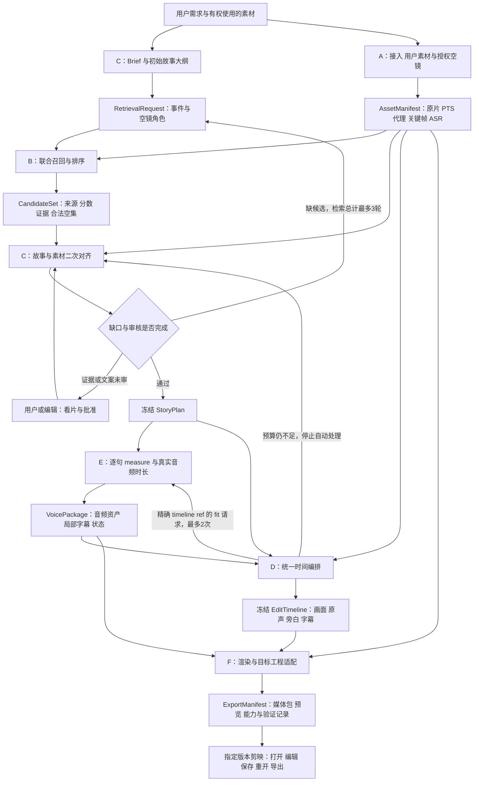

# QuickCut 全链路工程说明

本文说明 A–F 如何交接数据、在哪些条件下推进、修改后重算什么，以及如何判定交付。验收操作见 [ACCEPTANCE_RUNBOOK.md](ACCEPTANCE_RUNBOOK.md)。字段定义以 [contracts.md](contracts.md) 为准；规划稿与当前代码不一致时，在本文列出差异，不把设计目标当作运行时能力。

## 1. 基线、证据和当前完成边界

本文基于本次工作树阅读编写。工作树中已有其他集成改动，模块提交只是追溯起点，不表示当前树等同于任何单个提交。交付时还需记录实际集成 HEAD 和未提交差异。

| 模块 | 追溯基线 | 核对方式 |
| --- | --- | --- |
| A | `3c6d4e99f9df6ffe87a1efb2808f66728d807ea3` | 解析 PR 基线 `origin/pr-4`；阅读 `docs/ingestion.md` 与公开入口 |
| B | 本轮未指定冻结提交 | 联合检索接口按协议说明；不能把旧单源检索视为新接口已经贯通 |
| C | `620b24f277754d948ed69a8aba01d381a044e9f8` | 解析当前 HEAD；阅读 `quickcut/planning/` 与交付说明 |
| D | `38dcb8b16ea5e0089da5a94142a171e32ff8abba` | 解析 PR 基线 `origin/pr-2`；阅读 `quickcut/timeline.py` |
| E | `d1c6c95105fe33432735a34071e5312b604eb63c` | 本轮执行 `git rev-parse origin/pr-1`；阅读 `quickcut/voice_package.py` |
| F | 本轮未指定冻结提交 | 工程导出能力须以目标版本实机记录为准 |

全文使用以下标签：

- **已实现**：已读代码或当前模块交付入口支持该行为；不等于本轮在此机器复测通过。
- **本轮待验证**：存在实现或已有历史样例，但本轮尚无对应命令输出、真实媒体检查或人审证据。
- **计划**：需要新增实现、联调或产品决策；列入后文 P0/P1/P2，不承诺已有入口。

**已有主代理全仓实测：805 passed，33.55s，macOS / Python 3.13。**这是用户提供的本次集成回归证据，不是文档编辑期间重新运行的结果，也不能外推为其他工作树或远端 CI 已通过。新增媒体演示仍在运行，未取得结果前保持待验证。回归通过证明被测软件检查通过；真实 B 检索、Qwen 语义、真人看片与听审、自然语音、自动 fit 和剪映工程质量仍须分别验收。历史交付的声音时长和试听结论保留原来源，不复制为当前产品结论。

| 能力 | 已实现范围 | 本轮待验证 / 计划边界 |
| --- | --- | --- |
| 单源 MVP | 一次索引、prompt 检索、顺序剪辑项编辑、FFmpeg MP4 渲染；有 CLI/API/UI | 真实语义质量和编辑后故事/字幕一致性待验证；不等同新多源链路 |
| A 多源接入 | 资产身份与 revision、原片复制、PTS、代理映射、关键帧、分阶段缓存、可选 ASR、部分失败 | 普通话实测、手机旋转/HDR、长片性能、B/D/F 消费扩展字段待验证 |
| C 规划 | 三段大纲、分角色请求、候选白名单、事件证据审核、旁白审批、有限再检索请求、rule/fixed/Ollama selector | 真实 Qwen 语义与真实 B 多轮交接待验证；CLI 单次 run 不自行执行完整 B 循环 |
| E 声音 | 逐句 WAV、PCM 实测、局部字幕、缓存、measure/fit、系统 TTS 和可选 IndexTTS2 adapter | 当前机器声音能力、自然度与 D/F 实际混音待验证 |
| D 时间线 | `compile_timeline`；资产 union、硬切、1×、四轨、选中片段尾部余量扩展、逐条局部字幕偏移 | 已有全仓回归证据；真实字幕目检及自动 E–D 请求循环仍需独立验收 |
| C→E→D 初编桥接 | `quickcut.integration.build_from_plan/compile_from_voice`；C 校验、初测包门槛、独立版本号、资产 union；demo 负责 JSON 留档 | API 本身不保存聚合 JSON、不导出、不自动 fit；真实语义及完整编辑链路待验证 |
| 新 IR 预览 | `scripts/render_timeline_preview.py` 生成真实 MP4、独立全局 SRT 和报告；必需 ffprobe，含非零 PTS 对齐与全局帧量化修复 | 新媒体演示结果待取得；混合 MP4 与可编辑 SRT 不等于剪映工程 |
| F 交付 | 旧单源渲染可复用；新 IR 已有预览；黄金 ExportManifest 是协议示例 | 可编辑剪映包、实际导入与编辑保存重开仍需独立证据；不能依据 fixture 宣布成功 |

## 2. 两条 pipeline 的入口和数据结构

### 2.1 已有单源 pipeline

`quickcut index → quickcut search/basic → quickcut edit → quickcut render` 围绕一个 `IndexManifest`、一个 `Timeline.source_video` 和顺序 items 工作。旧时间字段通常为浮点秒；旧 item 的 `asset_id` 经常实际装的是 shot ID。`basic` 及已审阅中文样例还有各自的规划、配音、字幕保存路径，不能自动合并为一个已验证行为。

旧编辑复用索引，但 `update_timeline` 不会完整更新故事、旁白和字幕。它适合作为局部能力与回归基线。API/UI 存在不表示已经能接收 A 的多源 `AssetManifest`。新 JSON 不能直接传给旧 `quickcut render`。

### 2.2 团队多源 pipeline

新链路围绕八类 `0.1.0` 文档和项目内媒体工作，模块间先使用 Python 调用及版本化 JSON。无需为六人拆成六个网络服务；调度、任务存储和 UI 接入由 D 集成。生产级队列、取消、容量控制和用户隔离不属于当前已验证能力。



图中的回边表示交接责任与目标编排，**不表示当前已有一个命令执行全部箭头**。D 基线编译器只消费初次测量包；带 EditTimeline 引用的 fit 回复需要集成层匹配待处理请求后接收，不能直接冒充初次测量包。

## 3. A–F 的交接门槛

| 模块 / owner | 消费什么 | 必须产出什么 | 允许交给下游的条件 |
| --- | --- | --- | --- |
| A | 本地源清单、origin、许可说明、接入配置 | AssetManifest、原片、PTS sidecar、可用关键帧、代理映射、ASR 状态与处理报告 | 文件可定位；源区间合法；失败资产显式列出；B 只消费可用 `coarse_shot` |
| B | 当前 Manifest、当前 RetrievalRequest、冻结 encoder/排序配置 | 每 query 对应的候选或合法空集，带 segment/asset revision、来源、score profile | 请求与素材 refs 精确匹配；不把容器窗口、坏证据或越界片段交给 C |
| C | Brief、Manifest、Request、CandidateSet、事件审阅及批准文案 | StoryPlan、alignment、run、必要的下一轮请求 | `ready_for_edit`，无 unresolved gaps 与 pending reviews，所选事件证据和文案均有效 |
| E | 冻结 StoryPlan；fit 时另有 D 的请求；可选 previous 包 | VoicePackage、逐句音频、真实时长、局部字幕、错误和失效 cue | 最终安排要求所有所需 cue 可用且 fits；超时/部分失败是反馈，不是最终成功 |
| D | Brief、Manifest、StoryPlan、VoicePackage、输出规格 | 唯一全局 EditTimeline，精确 inputs、四轨、最终长度 | 引用一致、无源越界/非法重叠、语音放得下、全局字幕及原声一致 |
| F | 冻结 Timeline、Manifest 与 VoicePackage 的资产 union、目标版本能力 | 预览、素材包、可编辑工程、ExportManifest 与验证记录 | 媒体执行检查通过；真实工程验证与文件生成分别记状态 |

A 不判断故事真假；B 的相似分数不等于事件事实；C 不写最终成片时序；E 不改故事和镜头；F 不私自删轨、改词或静默把工程烧平。D 是唯一全局时间 authority。

## 4. 数据身份、版本和媒体解析

### 4.1 文档信封与精确 refs

公共信封包含 `schema_version/kind/document_id/project_id/revision/fixtures_only/owner/inputs`。revision 必须为正整数，不能用布尔值冒充整数。引用只使用精确三元组，例如：

```json
{"kind":"StoryPlan","document_id":"story-001","revision":2}
```

该引用指向特定 StoryPlan，不表示所有文档都必须是 r2。消费时核对项目、协议、kind、document ID 和 revision；不能取“目录最新 JSON”或仅按文件名猜版本。生产者内容变化后发布新 revision，保留旧文档与旧媒体。只改旧下游的 `inputs` 数字不能修复陈旧结果，必须重新核验或重算实际内容。

C 会核验 Request、CandidateSet 和 StoryPlan 依赖；D 编译器只对传入文档集合中的依赖做比较，不能代替完整 bundle 校验。E 无法从一台机器上的旧 fit 请求推断另一台机器已经发布了新 Timeline，因此当前 pending-request 检查必须由 D 的集成层负责。

`fixtures_only: true` 必须向下传播。音调、固定候选、固定模型响应、合成色块和占位工程均不能在真实交付时改标为非 fixture。

### 4.2 身份层级与资产 union

- `asset_id + asset revision`：特定真实文件版本；A 中同 origin 同内容可复用身份，user 与 external 分开注册。
- `segment_id`：某资产版本内的源区间；父级 `coarse_event` 是容器，检索通常消费 `coarse_shot`。
- `candidate_id`：某次检索结果中的候选；不能当作媒体文件路径。
- `beat_id/cue_id/track_id/clip_id`：分别标识叙事段、批准句子、轨道及具体落地片段。

D/F 的资产查找集合为：

```text
asset_registry = AssetManifest.assets ∪ VoicePackage.assets
```

D 已通过合并列表后按 `asset_id` 建唯一索引实现 union；重复 ID 即拒绝，不能后者覆盖前者。E 生成音频无需预先塞回 A Manifest。F 解析每个 clip 的 `asset_id + asset_revision`、URI 和哈希；任一缺失、冲突或版本不符都阻断导出。A 清单与 E 包必须使用同一项目根语义；不能把分别生成在不同 root 的相对路径直接拼起来而不复制媒体并验证哈希。

### 4.3 路径、版权与用户边界

公共媒体 URI 相对项目根，使用 `/`；拒绝绝对路径、反斜杠、目录越界和解析后经符号链接逃出项目根。A registry 中的外部绝对路径只用于本机 import alias，不进入公开交付包。旧单源产物若带绝对路径，迁移时必须显式重定位，不能宣称其天然可搬迁。

用户只提交自己拥有或获许可的素材；外部空镜、音乐、参考声音分别记录来源、许可说明、允许用途及需要的署名。`origin=external/generated` 是来源事实，不代表授权已经完成。许可不清的素材不能进入可分发 demo。对用户媒体、识别人声文本、模型原始响应和参考声音限制共享范围；权重及大素材不进入普通 Git。声音参考需有使用授权；只保存必要指纹与本机配置，公开证据去掉个人目录和无关私人信息。

## 5. 时间坐标与声音、字幕语义

| 坐标 | 原点和单位 | 用途 / 禁止混用 |
| --- | --- | --- |
| 源视频时间 | 首个解码视频帧为零；整数微秒 | A 的 `source_range_us`、关键帧与 ASR；不是容器 start_time 的直接拷贝 |
| 代理时间 | 代理从零起；逐帧 PTS 映射回源 | 预览选点；不能用平均 fps 乘帧号定位 VFR |
| 成片时间 | D 编排的成片起点为零；整数微秒 | `timeline_range_us`；不等于素材入点 |
| 句音频局部时间 | 每句 WAV 起点为零；整数微秒 | E 的 local subtitles；需 D 加全局音频起点 |
| 预算 | 非负或正整数微秒，按字段限制 | 规划上限；不是已经测得的音频时长 |

所有区间为半开 `[begin,end)`，长度为 `end-begin`。fps、playback rate 用分子/分母；当前 D 只输出 1×。媒体帧和音频样本不能假装具有任意连续精度。

A 使用 `(source_pts - source_origin_pts) × timebase` 转为微秒，保留真实 PTS。代理无音频、帧数一致、逐帧 timing 保持并归零，映射误差不得超过 2 微秒；否则代理阶段失败。原声仍取原片，ASR 提取时考虑相对视频原点的音频偏移。此容差是 A 代理映射约束，不能当作整个渲染链路都已达到的误差指标。

E 最终输出为 48 kHz PCM，时长来自样本数。区分 `engine_duration_us`、去边界静音后的 `raw_duration_us`、含句末 padding 的 `duration_us` 和不含新增 padding 的 `speech_end_us`。默认 padding 为 180000 微秒；不能把它误判成被剪掉的发音。音频微秒值有采样量化，SRT 为毫秒预览，JSON 是交接依据。

局部字幕映射为 `global = narration_clip.timeline_begin + local_range`，不能直接拼接多份从零开始的 SRT。**D 追溯基线与最新工作树有差异**：基线每 cue 生成一条覆盖整段 WAV 的字幕；最新工作树已逐条映射 `local_subtitles`，保持局部空隙和分段，字幕终点不再被强行延长到 WAV 尾部。E 标准输出的局部字幕终止于 `speech_end_us`，因此新增句末 padding 不进入字幕；若其他生产者的局部区间包含 padding，D 不会自行识别并裁去。逐条偏移已有实现与全仓回归证据；真实字幕逐句目检和目标工程可编辑性仍待验收。

新 preview 已处理非零 PTS：以首个解码视频帧为源原点，保留真实流时间并对齐原声。视频按全局时间线边界 `ceil(time_us × fps / 1_000_000)` 量化，相邻 clip 共用边界，总帧数为总长对应的向上取整值，避免逐段取整累积漂移。报告记录 `video_frame_quantization="ceil_global_timeline_boundaries"`、`video_frame_ranges` 与实测帧数；SRT 向下量化至毫秒，字幕不烧入 MP4。已修复这些工程问题不表示真实素材的音画和字幕质量已完成人审。

## 6. 事实人审、旁白审批与本地模型

事实人审回答“这段用户画面能否支持当前事件”；旁白审批回答“这句文字是否允许播出”。二者独立，不能以一个 `approved` 字段替代。

C 的 `--reviewed-evidence` 是以 candidate ID 为键的映射；有效记录绑定 `beat_id/event/asset_id/segment_id/asset_revision/source_range_us`，还需要非空 `reviewer/note`。资产版本、源区间或目标事件变化后必须重新审阅。fixture 的 `fixture_annotation` 只能证明夹具设置，不能算真人看片。空镜可承担 establishing/transition/detail/atmosphere 等职责，不得证明用户具体行为。

C 的 `--approved-cues` 当前是 `beat_id → 非空文案` 的映射。每段批准文本进入相应 cue；模板草稿保持 `approved: false` 并进入 `pending_reviews`。真实审批的操作者、时间、文本哈希和目标 StoryPlan ref 应在运行记录中另行留证；当前 CLI 的文案映射本身不是完整审批审计系统。C 当前只在缺口与待审均为空时返回 `ready_for_edit`；即使禁用旁白，用户事件的事实审核仍需要完成。

E 的 StoryPlan 校验并未独立强制逐 cue `approved`。最新 D 已检查故事无 gaps/pending reviews、声音包 ready 且无 errors，并保持 fixture 来源；这些检查仍不能替代 C 的逐 cue 审批和证据验证。**已有初编桥接** `build_from_plan/compile_from_voice` 会在运行 E 或编译 D 前调用 C validator，拒绝未批准文案及陈旧依赖；直接调用 E 或 `compile_timeline` 的调用方仍须执行同等门槛。最终导出也必须绑定已验证的那组输入。

rule 是确定性选镜；fixed 是固定响应；二者不能标为真实 Qwen 推理。Ollama 模式要保存候选白名单、实际附图及源时间映射、原始响应、模型标识、参数、耗时、程序修正和人工编辑。模型 JSON 合法不表示动作、角色和因果正确。C CLI 已支持 `run --project-root PROJECT_ROOT`，Ollama selector 使用该根解析图片；未传时默认 repo root。应传入 A Manifest 的媒体根，并保存实际附图与源时间映射，不能只凭 bundle 或合法 JSON 宣称已完成视觉验收。

### 6.1 尚未解决的 A/C 风险

- **ASR 跨窗口信息丢失**：A 将所有重叠 ASR spans 附到 shot，跨窗口句子可能重复；C 候选视图仅取 transcript 的扁平 `text`，未保留 status、span/range。shot 中出现某句话不证明整句都在该源区间内；真实检索与事实审阅需回看原声和时间范围。
- **默认窗口与 beat 容量**：A 默认 shot 为 3 秒，C rule 每 beat 只选一个 user 镜头（可另配 external），更长 beat 可能缺乏合法画面容量。demo 按最大 beat 预算主动扩大窗口，仅解决该合成用例的输入条件，不代表默认 A/C 容量问题已修复。
- **结构校验不重读媒体**：C `validate_story_plan` 核验传入 JSON 的 refs、候选、区间、预算、证据 provenance 和批准；不接受媒体根、不打开真实媒体或关键帧、不重算哈希。结构通过不能证明文件存在、片段可解码或具体事件真实；需 A/preview 媒体检查与真人看片补足。

## 7. E–D 有界重定时：最多三次处理

本轮将“最多 3 轮”明确为**同一 cue 的首次 measure + 最多两次 fit，总计最多三次声音处理**。现有 E 的 fit `iteration` 只能是 1 或 2，`iteration=3` 会被拒绝。若需求实际指三次 fit，需先改契约与实现；本文不把它当作已有能力。B–C 的三轮检索是另一计数器。

| 次序 | 动作 | 输入与退出条件 |
| --- | --- | --- |
| 1 | E `measure` | 批准 StoryPlan；按自然速度合成，完整保留超预算音频；无 Timeline 引用 |
| 2 | D 调整合法画面容量；必要时发 `fit iteration=1` | 精确 project、StoryPlan ref、待适配 Timeline ref、cue ranges；E 回显相同请求 |
| 3 | 在明确变更预算/配置后 `fit iteration=2` | D 校验回显仍对应当前 pending request；重新测量并记录变更理由 |
| 到上限 | 停止自动适配 | 仍超时交 D/C；C 缩写需重新批准并发布 StoryPlan revision，或用户调整目标 |

D 基线能在 beat、Brief 和所选 segment 的未用尾部容量内扩画面，优先延长段落末镜头。但已被 E 标 `needs_retime`、或超过 cue 预算时，D 基线会直接返回 `VOICE_NEEDS_RETIME`，下一 owner 为 C；它不会先自动跑上述全套回路。fit 请求的创建、匹配、轮数累计和结果应用属于集成层待验证/计划内容。不能靠删除输入中的 Timeline ref 把 fit 包伪装成 measure 包。

E `measure` 不变速；fit 必要时使用 FFmpeg `atempo`，默认允许 1–1.15 倍，配置硬上限 1.25。短句不为填预算而放慢；处理后再次测量。禁止截句尾、替换静音或扩大容差伪造 fits。C 改文案后新的内容尝试必须关联原失败记录，人工批准前暂停，不能通过不断升 revision 绕过自动循环上限。

## 8. 编辑复用与增量失效

索引描述源素材；时间线描述如何使用素材。替换已索引镜头、调边界、重排或改单句文案不应重建全素材索引。失效的是依赖修改的下游文档，不一定是所有可复用的媒体文件。

下表是**集成处理规则**。A 分阶段缓存、E 逐句缓存已实现；全链路依赖图与自动局部重算不能据此宣称已全部实现。

| 修改触发 | 必须失效 / 重新检查 | 可复用 | owner 与恢复动作 |
| --- | --- | --- | --- |
| 新增素材 | Manifest revision、依赖旧清单的请求/候选/故事/时间线/导出 | 旧资产阶段缓存；未变句子音频 | A 增量接入；B/C 针对需求重跑，不强制重编旧资产 |
| 同 alias 内容改变 | 对应 asset revision、segments、相关候选与事件审核，以及下游聚合文档 | 其他资产与无关句子的缓存 | A 重新导入源列表；B/C 重新定位与审阅 |
| ASR 模型/语言改变 | 相关 ASR、依赖转写的检索与内容判断 | 关键帧和代理 | A 重跑 ASR；B/C 检查实际受影响内容 |
| encoder/召回策略改变 | embedding/候选及相应 StoryPlan | A 解码事实、未改音频缓存 | B 冻结新 profile 并重建受影响语义索引 |
| 调整入出点 | Timeline 与 Export；事实审核绑定区间变化时审核也失效 | 源索引和未改文本的 WAV | D 检查源范围、动作上下文、原声、旁白和字幕 |
| 替换或重排镜头 | 新 StoryPlan/Timeline/Export；必要的事件证据与文案审核 | 已接入资产、已有 embeddings、文字/音色未改的 WAV | C 确认表达；D 重排全局时间 |
| 改一句旁白 | 新 StoryPlan、聚合 VoicePackage、该 cue 音频与字幕、Timeline/Export | 其他句子的音频及全素材索引 | C 审批；E 用 previous 生成新包；D 消费 invalidated cues |
| 只改一句音色/语速/参考声音 | 新 VoicePackage、该句音频/字幕和依赖时序 | 文本证据与其他音频 | E 合成并测量；D 重排受影响区间 |
| 只改画幅/导出参数 | Timeline 输出规格或 Export；需检查裁切影响 | 源索引、原始 WAV | D/F 新 revision，重新渲染并查工程一致性 |
| 搬迁项目 | 路径可定位与哈希检查；若只移动根目录不必改故事事实 | 合法相对 URI 和原媒体 | F 验证无旧绝对路径依赖；A 不自动扫描外部 alias |
| 缓存文件损坏/删除 | 对应阶段产物和依赖检查 | 其他通过哈希检查的阶段 | 资产 owner 局部补算；不得将损坏项视为命中 |

新 StoryPlan revision 会使旧 VoicePackage 的聚合引用过期；即使两句 WAV 命中缓存，也要发布引用新脚本的新包。E 的 `invalidated_cue_ids/alignment_invalidated` 是 D 的重排信号，不表示 D 已经执行重排。重排可能移动后续未改句子的全局起点，因此“只重做一句音频”不等于“只检查一句字幕”。

## 9. 状态、错误与重试归属

| 当前状态 / 条件 | 消费者动作 | 责任与下一步 |
| --- | --- | --- |
| A `processing.status=partial` | 保留成功资产；展示失败文件，不把全部素材标完成 | A 修复依赖/文件，重新传变更源；C 判断剩余素材能否满足要求 |
| ASR `no_audio/disabled/no_speech` | 区分三个原因；均不能当作识别失败 | A 记录状态；B 不把无文本当作事件不存在 |
| C `awaiting_candidates` | 等 B 返回对应请求的 CandidateSet | B；C 不编造候选 |
| C `needs_input` | 显示 gaps/pending reviews，阻断最终链路 | 候选问题 B，事实和文案 C/人工；检索最多总计三轮 |
| C `ready_for_edit` | 再核验精确依赖和审批，然后进入 E/D | C/D；该状态不代表音频和工程完成 |
| E `ready` | 检查全部需要的 cue、文件与引用 | D；空旁白 ready 不表示存在语音文件 |
| E `needs_retime` | 完整保留 WAV；进入有界处理 | D 统筹，C 必要时改词；当前 D 编译错误可能直接指向 C |
| E `partial/failed` | 阻断最终交付，不用缺句或静音补齐 | E 处理合成/声音能力错误 |
| D `ready_for_export` | 冻结并交 F 执行 | D/F；不等于真实导入成功 |
| F `generated` | 只表示文件生成，启动媒体和实机验证 | F |
| F `verified_import` | 必须附目标软件版本、系统、步骤及实机证据 | F；fixture/UNVERIFIED 不能声称该状态 |

| 错误码 / 故障类别 | 首接 owner | 处理与重试规则 |
| --- | --- | --- |
| `STALE_INPUT_REVISION` | 失效文档的生产者，D 协调 | 核对 expected/actual refs，重建受影响文档；相同输入盲重试无效 |
| `NO_CANDIDATE`、事件缺口 | B/C | 检查白名单/来源/坏证据，有限再检索；用尽后请求补素材或改故事 |
| `VLM_INVALID_PLAN` | C | 保存原始响应，检查非法 ID、重复、角色与预算；不得静默替成“模型成功” |
| `VOICE_NEEDS_RETIME` | E 反馈给 D；当前 D 错误可指 C | 保留时长和音频，检查预算与上限；禁止无限 fit |
| `TTS_FAILED/NO_SPEECH`、`UNSUPPORTED_VOICE/PARAMETER` | E | 区分配置、依赖和无声；先查 capabilities，再重试受影响 cue |
| `TIMELINE_INVALID` | D，必要时交源数据 owner | 检查区间、重复身份、cue 文本、资产 union 和输出参数 |
| 路径越界、缺媒体、哈希不符 | A/E/F 按资产归属 | 阻断；重新定位或局部再生成，不接受任意磁盘回退 |
| 不支持效果、工程格式或目标版本不兼容 | F | 返回能力差异，安排最小导入复现；不私自丢效果/轨道 |

公共日志建议使用 `status/code/stage/project_id/message/retryable/affected_ids/action_owner/detail`。C、D、E 已有各自错误序列化，A 有阶段/资产/尝试记录；并非每个模块都完整采用同一字段。统一错误规范和 UI 展示属于集成工作。模块退出码不同，不能将“进程为 0”直接等同成片成功，详见验收手册。

## 10. 日志、指标和可复现实验

**已有记录**：A 项目内 `.quickcut/run-report.json` 的阶段和缓存命中；C `run.json/alignment.json` 的 selector、原始响应、审核、修正与缺口；E 的 profile、缓存键、实测时长、fit 请求回显和错误；D 编译结果/错误 JSON。统一 demo 已在项目根写 `run-report.json`，含 Git 状态/源码哈希、capabilities、阶段耗时、A/E/D 调用次数、产物映射、媒体检查、编辑缓存与失败反馈；它与 A 的隐藏目录报告是两个文件。preview 另写 `TimelinePreviewReport`，不回写 demo 的 `render.executed=false`。完整真实 A–F 调度的统一 run ID、资源与重试追踪仍待集成。

每次验收至少保存以下信息；缺失填“未采集”，不能填零或推测值：

| 维度 | 建议记录字段 | 判读方式 |
| --- | --- | --- |
| 版本 | 集成 HEAD、工作树差异、A–F refs、输入输出 document refs、文件哈希 | 能唯一定位被测代码与媒体；分支名不足以复现 |
| 环境 | OS、Python、依赖、FFmpeg/ffprobe、引擎、模型权重指纹、设备和 seed | 区分首次下载、模型加载、冷运行与热运行 |
| 时延与资源 | 阶段起止/elapsed、媒体分钟数、峰值内存/显存、处理倍率 | 同机器同集对比；没有实测不填承诺吞吐率 |
| 缓存 | 阶段/句子 hit/miss、失效理由、重做资产/句子数 | 编辑后证明没有全量重建索引 |
| 检索 | query、top-k、人工源区间、R@1 at tIoU 0.5/0.7、multi-span mAP、空集率；Recall@k 可补充 | 按 source split 与 query 类别统计；CLIP Score 仅辅助，不能替代人工 spans |
| 故事 | 事件覆盖、无依据断言、角色/因果错误、空镜比例与缺口 | 人工逐事件对照源时间，不能只看 JSON |
| 声音 | 实际/预算时长、tempo、fit 次数、失败 cue、末句完整性、试听结果 | ASR 仅辅助核验，不替代听审或覆盖批准字幕 |
| 时间线与导出 | 越界/重叠/缺文件数、总长、轨道、字幕偏差、全量解码、工程实机结果 | 技术红线先过，质量分不掩盖阻断问题 |

真实素材路径、转写与模型原始图像具有用户内容属性，日志与公开报告分开存放。分享报告时保留必要哈希、相对路径和审核证据，避免复制用户原片或个人绝对目录。

## 11. 环境、目录和可用入口

基础使用 Python 3.10+。FFmpeg 与 ffprobe 需要在 PATH；A 支持 `QUICKCUT_FFMPEG/QUICKCUT_FFPROBE`，E 当前直接调用 `ffmpeg`，因此不能只设置 A 环境变量就认为 E 可运行。A 代理需要 libx264、PNG 与 `-fps_mode`；旧字幕预览需检查 libass、中文字体，真实音频适配需要 atempo。`imageio-ffmpeg` 不保证同时提供 ffprobe。

安装按功能选择：`.[ingest,dev]` 为接入与测试；`.[asr]` 启用 faster-whisper；`.[ml]` 为 OpenCLIP；`.[server,ui]` 为旧 API/UI；`.[runtime]` 提供辅助 FFmpeg 依赖。`all` 不等于安装系统工具、Ollama、模型权重或 IndexTTS2。详细准备步骤见验收手册。

Qwen/Ollama、ASR、OpenCLIP 与 IndexTTS2 都是可选能力。基础 fixture 不需要权重；真实语义验收必须启用对应真实模型并记录实际 backend。首次下载依赖网络，正式离线推理前验证模型缓存；下载失败与推理失败分开计。IndexTTS2 使用隔离 Python 3.11 环境、固定 runtime/权重 revision、已授权参考音频和设备配置，按 [E-local-voice.md](E-local-voice.md) 复现。系统 TTS 与神经 TTS 分别试听，不能泛化平台支持。

| repo 位置 | 用途 / 入口边界 |
| --- | --- |
| `quickcut/cli.py`、`core.py`、`types.py` | 旧单源 CLI 与模型；index/search/edit/render 不直接消费新 IR |
| `quickcut/api.py`、`ui.py` | 旧服务与工作台；团队链路接入需要另验 |
| `quickcut/ingest.py`、`media.py`、`asr.py` | A 接入；`python -m quickcut.ingest` 或 `quickcut-ingest` |
| `quickcut/planning/` | C；`python -m quickcut.planning run/validate/inject/selftest/compare` |
| `quickcut/timeline.py` | D 的 `compile_timeline` 函数；最新工作树含逐条字幕偏移和 ready/fixture 门槛 |
| `quickcut/integration.py` | C→E→D 初编 Python API：`build_from_plan`、`compile_from_voice`、`IntegrationResult/IntegrationError`；demo 调用此桥接 |
| `quickcut/voice_package.py`、`indextts2.py` | E；`python -m quickcut.voice_package` |
| `examples/team_contracts/` | 八文档 fixture、`validate.py`、D demo；不含完整真实媒体 |
| `examples/ingest/`、`examples/voice_package/` | A 源清单示例；E 脚本配置、局部音频字幕及历史证据 |
| `scripts/smoke_demo.py`、`smoke_ingest.py` | 旧单源与 A 的生成媒体演示 |
| `scripts/demo_voice_package.py`、`verify_voice_package.py` | E 声音/修改/失败演示及独立验证 |
| `scripts/review_c_planning.py` | C 审查入口，具体参数以脚本帮助为准 |
| [doctor_pipeline.py](../../scripts/doctor_pipeline.py) | 只读离线预检；`--require-media` 强制必需项，`--project-root` 增加 A 清单检查 |
| [demo_pipeline.py](../../scripts/demo_pipeline.py) | 合成媒体 A→人工候选→rule C→E 音调→D JSON；supported/unsupported/edit，目标 5/10/15 秒 |
| [render_timeline_preview.py](../../scripts/render_timeline_preview.py)、[timeline_preview.py](../../quickcut/timeline_preview.py) | 新 IR 媒体执行，MP4 + 独立 SRT + 报告；不是剪映 exporter |
| [pipeline-integration.yml](../../.github/workflows/pipeline-integration.yml)、[c-planning.yml](../../.github/workflows/c-planning.yml) | Ubuntu / Python 3.10、3.13；具体检查与产物见验收手册第 10.1 节 |
| `tests/` | 已有主代理 805 项全仓回归证据；真实模型与质量验收另记 |
| `docs/PROJECT_GUIDE.zh-CN.md`、`docs/team/` | 设计、职责、契约、模块交付与本文 |
| `output/` 与运行时 `outputs/` | repo 已有产物与各脚本默认输出可能不同；不要靠目录名判断有效版本 |

### 11.1 已有 C→E→D 初次编排 API

`build_from_plan(result, *, brief, manifest, candidate_set, root, output, fixture=False, config=None, mode="measure", previous=None, voice_revision=1, expected_story_revision=None, timeline_document_id="timeline-001", timeline_revision=1)` 消费 C `plan()` 的 `PlanResult`。先核验 Request、CandidateSet、StoryPlan 的精确依赖和 C 审批，再调用 E，只有 ready、无错误、各 cue 均 fits 的初测包才进入 D。`root` 是 A/E 共用项目根；`output` 包含 width、height、有理数 fps 与 sample_rate。`previous` 只用于 E 缓存复用，不允许绕过新的脚本引用。

已有声音包时，用 `compile_from_voice(result, voice, *, brief, manifest, candidate_set, output, expected_story_revision=None, timeline_document_id="timeline-001", timeline_revision=1)`；它执行同样的 C 门槛，拒绝旧脚本或带 Timeline 引用的 fit 包。两个 API 返回 `IntegrationResult.story_plan/voice_package/timeline/assets`，各文档 revision 可独立递增；assets 为 A/E 合集，不回写 A。`fixtures_only` 按上游传播，真实故事配测试音调仍产生 fixture 时间线。

调用方负责保存返回 JSON、运行独立媒体核验和听审。`build_from_plan` 会让 E 写 WAV、局部 SRT 和缓存，但桥接不保存 JSON、不渲染、不导出，也不执行 fit 循环。桥接拒绝抛 `IntegrationError`；非 ready E 反馈保留在异常的 `voice_package`，`to_dict(project_id)` 提供结构化状态。C 的 `PlanningError` 与 D 的 `TimelineError` 原样上抛，调用方需分别留档。桥接收到 `needs_retime` 时 owner 为 D；直接 D 编译器的同类错误仍可能指 C，不要抹平两种来源。相关回归入口是 `tests/test_integration.py`；全仓实测口径见第 1 节，不能把该回归替代真实模型和声音质量验收。

### 11.2 已有工程脚本与报告交接

从 repo 根运行；demo root 必须不存在或为空，且不能是符号链接。以下列出命令和预期，新增媒体演示尚未取得结果：

```bash
python scripts/doctor_pipeline.py
python scripts/doctor_pipeline.py --require-media
python scripts/demo_pipeline.py --root outputs/acceptance/pipeline-10s \
  --case supported --target-seconds 10
python scripts/doctor_pipeline.py --require-media \
  --project-root outputs/acceptance/pipeline-10s
```

doctor 默认即使 `status=degraded` 也退出 0；严格模式必需项失败退出 2。它只检查工具版本、默认系统 TTS 可执行文件、安装元数据和可选 A Manifest，不下载、不推理、不试听、不全量解码。未传项目根时不要求已有媒体；缺少可选模型包不单独使严格检查失败。

demo 仅 `ready_for_render` 退出 0；unsupported 的 `needs_input`、5 秒固定音调的重定时和其他失败均退出 2。10 秒 supported 预期调用 A1/E1/D1；10 秒 edit 预期 A1/E2/D2，仅 cue-02 缓存失效，cue-01/03 命中；unsupported 预期 A1/E0/D0。5 秒 supported 顶层为 `failed`，反馈 `VOICE_NEEDS_RETIME/needs_retime`、owner D、cue-03，A1/E1/D0；保留声音包但不生成时间线，不自动 fit。`fixturesOnly=true` 必须保留；A 的 `manifestFixturesOnly=false` 只表示处理了真实编码文件，不表示实拍、真实 B、Qwen、语音或人审。

成功后从根目录 `run-report.json["render"]["files"]` 读取 `timeline/manifest/voice_package/assets_union`，各 URI 相对该项目根。`--manifest` 必须使用其中的 A Manifest，不能传 `assets_union`；edit 的映射会指向 r2，不猜 r1 或“最新文件”。preview 的可执行映射示例见验收手册第 5.3 节。

```bash
python scripts/render_timeline_preview.py \
  --timeline outputs/acceptance/pipeline-10s/timeline-r1.json \
  --manifest outputs/acceptance/pipeline-10s/asset-manifest.json \
  --voice-package outputs/acceptance/pipeline-10s/voice-package-r1.json \
  --project-root outputs/acceptance/pipeline-10s \
  --output outputs/acceptance/pipeline-10s/preview.mp4 \
  --srt outputs/acceptance/pipeline-10s/preview.srt \
  --report outputs/acceptance/pipeline-10s/preview.preview.json
```

上例文件名仅对应这次单轮 supported 命令，正式调度仍读取映射。preview 必须能找到 ffmpeg 与 ffprobe（PATH 或 `QUICKCUT_FFMPEG/QUICKCUT_FFPROBE`），成功退出 0，输入/校验/媒体运行失败退出 1，参数解析错误退出 2。输出父目录须存在，三个输出文件均不得存在；未指定时 SRT/报告默认同名 `.srt/.preview.json`。输入 refs、路径、A/E union、哈希、源范围与全量解码均过门槛后才发布。报告含 `status=preview_rendered`、ffprobe 实测总长/流时长/帧数、`full_decode_verified=true`；同时保持 `editor_project_exported/editor_import_verified/f_acceptance_completed=false`。独立 SRT 可编辑，混合 MP4 不提供剪映的独立可编辑音轨或工程。

## 12. 时长规格、评测与三种演示

已实际提取并核对本机 `CV Proposal.pdf`（`/Users/zicheng/Downloads/CV Proposal.pdf`）：第 1 页 **BACKGROUND** 明确约 **5 分钟源视频 → 5–15 秒相关短片**；同页 VISION 的 Basic 愿景是约 **45 秒 Vlog opening**。旧 repo MVP 为 **5–60 秒**、Basic 默认 30 秒，黄金协议 fixture 为 **18 秒**。这些口径用途不同；本次短片产品验收以 **5–15 秒**为准。

保留 18 秒 fixture 验证协议和 D/E 边界，另用真实 5、10、15 秒 Brief 验证短片；不截断末句来压缩旧 fixture，也不把旧 30/45/60 秒能力算作短片验收。C/D 在执行前冻结总长测量方式和帧/样本量化容差。5 秒合成 demo 当前的固定音调会触发 `needs_retime`，这是保留的工程负例，不代表 5 秒真实产品已达标。

正式评测采用 **5–10 个独立源视频、30–50 条 prompts**，按源视频/事件组划分开发与 heldout；同一原片的裁切、转码、邻接片段不能跨集合。先冻结分组、标注、指标、模型与配置，再运行 heldout；看到 heldout 后改 prompt、候选或规则，必须记为调参并更换未见集合。具体分配与记录格式见验收手册。fixture、自写例子与历史中文视频不自动进入独立 heldout。

proposal 第 2 页 **EVALUATION PROTOCOL** 指定源时间线 **R@1 at tIoU 0.5/0.7** 与 **multi-span mAP**；对比系统 A（vision-only similarity + crop）、B（vision + transcript + temporal refinement + timeline）、C（B + gap fill + edit loop），并逐次移除一个模块做消融。这里的系统 A/B/C 是实验配置，不是团队分工 A/B/C。成片做 relevance/coherence 盲偏好；编辑任务覆盖 replace/trim/caption，检查只改变目标项且仍在 5–15 秒；另报 export success rate 和阶段耗时。CLIP Score 仅作辅助，结论依赖人工相关 spans 与偏好。Minimum deliverable 要求 supported query、unsupported query 和完整 edit round-trip；当前合成 demo 仅覆盖相应工程路径，不替代真实评测。

演示分三种，每种都带输入、操作、产物与失败出口：

1. **prompt 定位演示**：已有索引上换请求，得到可回溯片段；包括一个无证据请求，展示合法空集或缺口。
2. **短片生成演示**：使用 5–15 秒目标，展示故事、素材证据、授权空镜、逐句声音、四轨时间线与交付；当前模块分演只算阶段证据，完整团队演示需真实串联。
3. **编辑闭环演示**：替换/重排一个镜头，修改一句旁白，发布新 revision；证明未重建素材索引、只重合成变更句子，并重新校验后续字幕和导出。剪映精修必须实机展示。

这三种是本轮执行安排；repo 项目指导稿还要求单长片、多短片、长短混合三类输入，它们应交叉覆盖，而不是与三种演示混为一谈。

## 13. 分级工程工作清单

优先级表示依赖与交付门槛，不代表未经验证的完成承诺。owner 使用 A–F；D 主责全链路编排，各模块仍负责本模块测试。

| 优先级 / 工作 | 当前状态 | owner | 依赖 | 验收条件与证据 |
| --- | --- | --- | --- | --- |
| P0 冻结范围与 refs | PR 基线和 proposal 范围已核实；运行 refs/量化容差需冻结 | C/D | proposal 5–15 秒、旧规格 | 决策记录区分 5–15、18 fixture、5–60；完整集成版本与输入 refs 可追溯 |
| P0 公共消费与资产解析 | C/D/E 部分已实现；全链路待验证 | D，A/B/C/E/F 配合 | 0.1.0、同一项目根 | 正确资产 union；重复 ID、旧 revision、越界 URI、缺文件均阻断 |
| P0 真实检索与证据审核 | C 门槛已实现；B/C 实测待验证 | B/C | A 的可用 coarse_shot、模型配置 | 中英文/ASR/空镜请求有相关集合；事实人审与文案审批独立留证 |
| P0 有界声音与时间编排 | C→E→D 初编 API 已有；自动 fit 循环仍待集成/验证 | D/E，C 改词 | 批准脚本、实测 WAV、精确请求 | measure+2 fit 上限、旧回复拒绝、超时完整保留、末句不截断 |
| P0 多源媒体执行 | 新 IR preview 已实现；新增媒体演示结果待取得 | F/D | 冻结四轨与资产 union | 多源全量解码通过，原声与旁白独立；预览与工程同一 Timeline ref |
| P0 最小剪映工程 | 计划 / 实机待验证 | F | 两视频、文字、独立音轨、目标版本 | 打开、分别编辑、保存、重开、搬迁重定位、再导出；证据附版本 |
| P0 真实短片与 heldout | 本轮待验证 | 全组，D 汇总 | 上述链路、冻结数据集 | 5–10 视频和30–50请求计划执行；真实5/10/15秒；阻断项不被平均分掩盖 |
| P0 编辑不重建索引 | A/E 缓存已有；团队闭环待验证 | D，各模块配合 | revision 与失效图 | 替换镜头/改单句前后对照；索引哈希不变、仅相关音频变化、新导出引用一致 |
| P1 字幕同步与可编辑交付 | D 逐条偏移与独立 SRT 已实现，已有全仓回归；真实目检/工程实机待验证 | D/E/F | local subtitles、音频偏移、目标工程适配 | 多段偏移与间隙正确；标准 E padding 不进入字幕；真实片逐句目检、工程可编辑、末句不出界 |
| P1 真实媒体覆盖 | 本轮待验证 | A/F | VFR、非零起点、横竖屏、普通话、HDR | 源/代理/导出逐帧定位与画面声音检查，标注不支持格式 |
| P1 统一运行与观测 | doctor/demo/preview 与 CI 已有；真实 A–F 统一调度待集成 | D | 错误信封、阶段日志 | 一个 run ID 追溯全部 refs、失效原因、时延、缓存、资源和重试 |
| P1 模型与声音对照 | adapters 已有；质量待验收 | B/C/E | 冻结权重、设备和授权参考 | rule/fixed/真实模型分栏；同文系统TTS与IndexTTS试听、成本及失败可复现 |
| P2 场景与局部边界优化 | 计划 | A/D | 标注和基线指标 | 相比固定窗口改善边界完整性，同时记录额外成本 |
| P2 产品级调度与扩展 | 计划 | D/F，相关模块配合 | 单机闭环稳定 | 容量、取消、中断恢复、隔离及更多目标编辑器有各自验收；不提前拆微服务 |

每个任务关闭时提交版本、命令、输入/输出引用、原始日志、自动检查与人工判定。只有模块 JSON 成功、只有一段历史 MP4、或只有 fixture 通过，都不能关闭“真实端到端可精修工程”任务。
