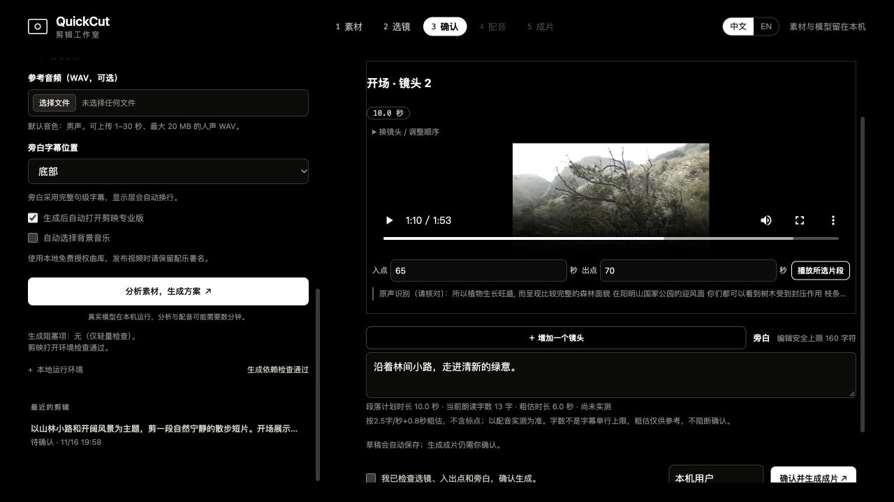

# PR #13 / #14 集成审核（2026-11-20）

基线 `d1738570adde349330c3896a658f29494e2a54c6`；保留两个作者分支的原提交历史：

- [PR #13](https://github.com/Tt200411/QuickCut/pull/13)：`6e859985dc1930b5aa7358a765b8f91934716bb7`，可选本地背景音乐。
- [PR #14](https://github.com/Tt200411/QuickCut/pull/14)：`02ba58f664f224a9ee622a7c8c16b9cce65c9ccd`，单屏工作台与独立单视频演示脚本。

## 合并决策

网页冲突同时保留 #14 的单屏、双栏独立滚动、逐镜查看和中英文切换，以及 #13 的配乐开关、曲库可用性、署名和五轨结果说明。配乐默认关闭，曲库未准备好时不能勾选。真实 A–F 网页链路继续使用 IndexTTS 与任务参考音频，不切换到系统语音。

`scripts/run_full_demo.py` 使用仓库既有单视频接口和系统语音，明确标记为旧接口演示，不作为当前 A–F、参考音色或剪映交付验收。当前生产入口仍是 `QuickCut.command`。

## 发现并修复

1. 新网页每两秒刷新会把正在播放的镜头重新定位到入点；普通刷新及窗口布局变化现在保留播放位置。
2. 原分页按段落而非镜头展示，多镜头段落没有真正逐镜确认。改为每页一个镜头，每段共享一份旁白编辑器；隐藏镜头的入出点仍完整保存和提交。
3. 英文显示缓存可能覆盖新状态并显示旧结果；缓存现在识别动态文本变化。恢复确认者默认值，并禁止直接打开确认后才执行的配音步骤。
4. 配乐选择依据和音量处理记录原先只存在可覆盖的顶层文件；现在在每次修订中留档，导出失败也保留当次证据。
5. 手工提供的配乐资源 ID 若与提取原声资源相同，会先生成无法验证的工程包；现在在发布前拒绝冲突。
6. 演示脚本的 `--model` 没有传递到真实规划器，且错误地接受同系列其他模型标签。现在精确核对请求及实际模型，下载绑定同一本机端点，配音前拒绝不匹配结果。
7. 演示脚本可能覆盖上次输出、无提示缺少 ASR。现在默认使用独立输出目录、拒绝覆盖指定目录，并明确要求 faster-whisper；帮助与结果标明旧接口范围。

## 验证

最终本地全量 **1374 passed in 49.10s**，JavaScript 语法与 `git diff --check` 通过。专项测试覆盖上述回归、工程安装、历史修订、旁白确认、原声/配音完整性及冻结 D/E 适配记录。

已从官方地址安装三首约 27 MiB 的音乐并校验固定 SHA-256。曲目及[作者使用说明](https://www.scottbuckley.com.au/library/using-this-music/)已核对；发布时应保留署名，工程包包含 `MUSIC_CREDITS.txt`，页面亦显示归属。原 MP3 保存在本地忽略目录，没有提交进代码仓库。

对原真实任务 `ac91f60c01ca` 的只读素材及已批准男声 IndexTTS WAV 进行新的 F 验证：

- 生成 30 秒带配乐 MP4 和独立剪映工程包，`verify_package` 通过。
- 配乐为准确 1,440,000 帧、48 kHz 双声道 PCM；剪映工程包含五条独立轨道。
- 原四轨、D/E 适配回执、批准文本、字幕时间和历史输入文件哈希不变；没有重跑神经模型或重新合成旁白。
- 合成测试音的独立检查测得旁白期间音量比为 0.23996，与配方 `.06 / .25` 一致；淡入、淡出、循环和缓存复用通过。这不是主观音乐听感评分。

浏览器使用隔离的历史草案副本，1280×720 实测五镜分页、中英文切换、男声默认音色、可用且默认关闭的配乐开关、禁用的配音直达步骤及正常连续播放；65 秒入点播放至约 70 秒后停止，未被两秒轮询拉回。控制台无警告或错误，未提交新的生成确认。

[结构化证据](evidence/pr13-pr14-review-20261120.json)。完整本地视频、工程和浏览器截图在 `outputs/pr13-pr14-real-review-20261120/`，全量日志在 `outputs/pr13-pr14-full-regression-20261120.log`。

## 边界

配乐选择是小型本地曲库的标签匹配，无匹配时明确记录默认曲目；不是音乐生成或节拍识别。音量变化预先写入独立音乐 WAV，未声称剪映音量包络可逐点编辑。未执行新版工程在剪映中的打开、编辑、保存和重开视觉验收，也未运行旧演示脚本的完整神经推理。此前字幕适配器 0.1.0 工程包需重新导出的边界保持。
