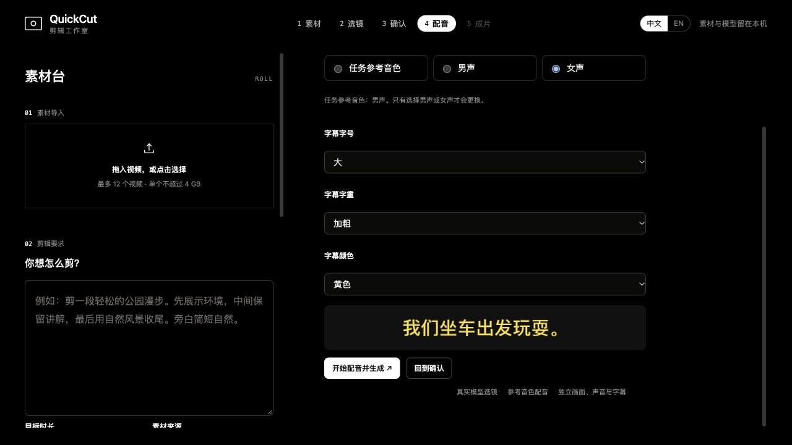

# PR #15 集成审核（2026-11-20）

[PR #15](https://github.com/Tt200411/QuickCut/pull/15) 作者提交 `00a61c9ef83d57d4751774bd3355251900650d67`；集成基线 `b28ebb54620de0a532612d32d7a98cdfd145ca31`。保留作者提交历史，解决网页和生产流水线冲突，继续保留上轮的逐镜分页、连续播放、配乐第五轨及不可覆盖的修订记录。

## 本次能力

确认镜头及旁白后先进入配音设置，再明确启动生成。可选择任务原参考音色、男声或女声，并调整字幕字号、字重及白/黄/黑色；这些设置用于 IndexTTS、MP4 烧录字幕和剪映文字。结果视频按导出修订更新，下载接口禁止缓存旧成片。

## 发现并补修

1. 原 PR 默认提交男声，会替换上传的参考音频。现在默认保留任务原参考音色，仅在明确选择男女预设时切换；缺失预设在页面禁用。
2. 原 PR 直接覆盖 `reference/voice.wav`，导致旧修订配置指向新的声音。预设现在按实际 SHA-256 保存独立 WAV，保留最初配置并支持切回；历史参考文件不改写。
3. 无效字幕请求原先可能在返回错误前已经换掉音色。先验证全部请求字段及参考音频；非法类型和仍在运行的任务在修改文件前拒绝。
4. 配音选择按任务和草案修订暂存，轮询及刷新可恢复，切换任务不会串用；提交期间禁用编辑和重复生成。进入配音页立即可操作，同时仍需勾选检查才允许生成。
5. 非对象或 list/dict 等非法样式值原先触发未捕获异常，现在统一拒绝。新黑色字幕在剪映中缺少白色描边，已补齐对比描边；未设置新样式的历史包保持原序列化。

## 验证

- 最终本地全量 **1426 passed in 59.45s**，JavaScript 语法及差异格式检查通过。测试覆盖声音切换/恢复、历史引用、拒绝请求无副作用、重复提交、刷新恢复及导出样式。
- 真实像素检查覆盖大小、粗细、黄/黑/白色，以及最大号粗体在横竖屏顶部/底部的安全边距；批准文本、句级时序和规范 SRT 保持不变。
- 浏览器以隔离草案副本验证确认→配音、默认保留原音色、男女预设可用、中英文切换、设置在轮询及刷新后保留；1280×720 页面无横向溢出，控制台无警告或错误。新成片完整播放至 30 秒，未被轮询重新加载。
- 另一隔离副本复用历史任务 `1c1bb824f8a9` 的真实 A–C 草案、已批准旁白和媒体，通过新确认接口选女声、大号、加粗、黄色，标记 `assistant_review`，实际执行 E–D–F。没有重复运行 A/B/C，也没有冒充本次真人确认。
- IndexTTS2 实际运行约 **121.64 秒**；三句均 `cache_hit=false`，参考哈希为 `a44e2a19b3402b43bec9ee86c9cbbaf21f11ce4c0beaba1e19fa7a241fc949ec`，匹配 ZIP 中的 `魅力游移型女1.wav`，与原男声不同。三句 WAV 实测约 3.21、4.68、1.68 秒。
- 生成 30 秒 MP4 和四轨剪映工程，包校验通过，导出文字为大号、加粗、黄色并含对比描边。原历史任务九份输入文件（含配置及参考音频）的哈希不变，隔离副本的初始男声参考也未覆盖。此次配乐未开启；原配乐第五轨回归通过。

[结构化证据](evidence/pr15-review-20261120.json)。本地视频与工程位于 `outputs/pr15-real-review-20261120/ui-jobs/f15e20261120/export-r1/`，全量日志为 `outputs/pr15-full-regression-20261120.log`。

## 范围

本次验证真实女声推理、文件完整性、页面交互、字幕像素与工程序列化；未进行新版样式在剪映中的打开、编辑、保存和重开视觉验收，也未把旧 A/B/C 结果记为本次重新推理。字幕仍是完整句级显示，不声称词级声学对齐或自动验证 TTS 漏读。
