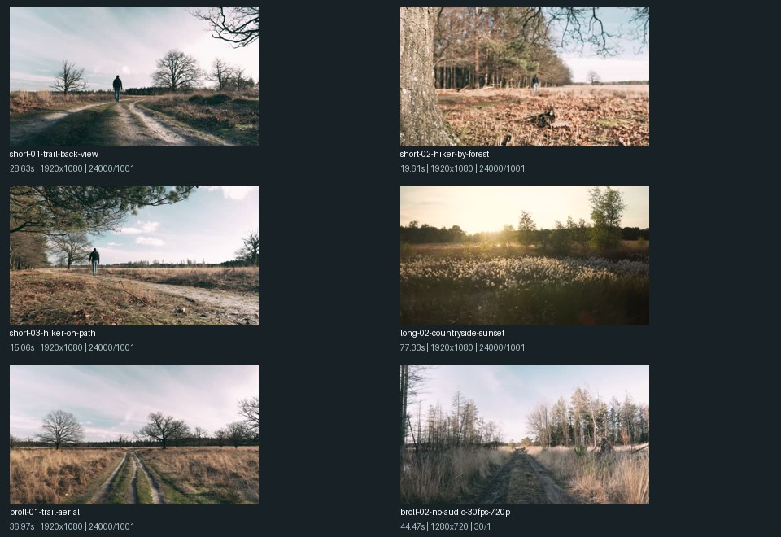

# A: Countryside demo materials

This collection supports the handbook's first material sample: three different-length short clips, one long clip, two B-roll clips, at least one file with no audio track, and different frame rates and resolutions. The user approved publicly licensed footage for the demo. All sources remain marked `external`; intended main-content use is recorded separately in `material-roles.json`.



## Files

| Input | Duration | Resolution | FPS | Audio track |
| --- | --- | --- | --- | --- |
| `media/short-01-trail-back-view.mp4` | 28.63 s | 1920x1080 | 24000/1001 | yes |
| `media/short-02-hiker-by-forest.mp4` | 19.61 s | 1920x1080 | 24000/1001 | yes |
| `media/short-03-hiker-on-path.mp4` | 15.06 s | 1920x1080 | 24000/1001 | yes |
| `media/broll-01-trail-aerial.mp4` | 36.97 s | 1920x1080 | 24000/1001 | yes |
| `media/broll-02-countryside-aerial.mp4` | 44.48 s | 1920x1080 | 24000/1001 | yes |
| `media/long-01-mandarin-park-guide.webm` | 113.38 s | 1280x720 | 30000/1001 | yes |
| `media/long-02-countryside-sunset.mp4` | 77.33 s | 1920x1080 | 24000/1001 | yes |
| `variants/broll-02-no-audio-30fps-720p.mp4` | 44.47 s | 1280x720 | 30/1 | no |

Use `story-sources.json` for the six-file countryside montage. `sources.json` includes eight files: the six story inputs, the preserved original of the no-audio B-roll variant, and a separate Mandarin guide for ASR. These are seven independent source recordings, not eight. The original and its variant are not independent recordings.

## Adaptations and source terms

The six countryside recordings are by **Matthias Groeneveld**, under the [Pexels License](https://www.pexels.com/license/). Source-page links and hashes are in `inventory.json`. The long sunset recording was downscaled to 1080p to keep the repository file below GitHub's single-file limit; its original 4K source hash and the changes are recorded. No scenes were concatenated, repeated, trimmed or given synthetic narration.

`variants/broll-02-no-audio-30fps-720p.mp4` is an explicit test adaptation: audio removed, scaled to 720p and converted to constant 30 FPS. It tests no-audio handling and mixed frame rates; it is not evidence of native phone variable-frame-rate coverage. Its unmodified parent is retained.

The Mandarin guide is by **Yangmingshan National Park (ymsnpinfo)**, [CC BY 3.0](https://creativecommons.org/licenses/by/3.0/). [Source page and published transcript](https://commons.wikimedia.org/wiki/File:陽明山國家公園_冷水坑觀景台.webm); [original publication](https://www.youtube.com/watch?v=9Da0YpRsJeE). The full downloaded recording is preserved under a different filename. Retain creator, source and license when sharing, and identify later changes.

Pexels permits downloading and editing but lists restrictions, including implying endorsement and redistributing on other stock platforms. These files are project test inputs; no model, narrator or park endorsement is implied. Media licenses are separate from the repository's code license.

## Story handoff

`brief-proposal.json` contains a Chinese brief and three proposed beats: countryside setting, walking and woodland views, sunset closing. It is a draft for C review, not an approved StoryPlan. `retrieval-expectations.json` supplies B with retrieval examples and a deliberate missing-evidence case.

These sources may show different seasons, dates and places. Use them as a thematic montage. They do not establish one continuous outing or a group member's identity. The Yangmingshan guide is excluded from the countryside story, and its narration must not describe unrelated scenery.

B should use the explicit demo roles when selecting publicly sourced main content; treating every external source as B-roll would exclude the demo's main shots. C approves the story and narration; E produces approved speech; D/F arrange and render the final result.

## Checks and ASR scope

All delivered files have recorded hashes and media metadata. Unmodified files were hash-checked against the previously fully decoded originals; the new 1080p long clip was fully decoded and scanned independently. The six countryside originals contain silent audio tracks. The converted B-roll has no audio stream. The guide is the separate speech input.

The local A validation of the original material collection produced 146 segments and checked real ASR, proxy timestamps, cache reuse, missing input and absent model weights. The repository's long clip is a new 1080p derivative with a different content hash. It was separately imported and validated: 29 segments, 26 usable shot candidates and zero microseconds of proxy timestamp error, with ASR explicitly disabled. Import the delivered collection to generate a shared project manifest; old IDs and caches are not included as though they described the new file.

`asr-check/` retains the raw base-model result for the unchanged guide and a hash-bound comparison against the user-confirmed opening passage. The 33-character passage had 3 substitutions (CER 9.09%) in this full-recording run. Its approximate 4.5-12.4 second selection and results apply only to that passage, not to overall recognition accuracy. Only its text was human-confirmed; the full transcript still requires review. The local model path in the exported profile is normalized to `base`; model revision and weight hashes are preserved.

## Import

Use A's ingestion implementation from [PR #4](https://github.com/Tt200411/QuickCut/pull/4), or a branch containing that implementation. With its dependencies and FFmpeg/ffprobe available, run from the repository root:

```powershell
python -m quickcut.ingest --sources materials/A-countryside/sources.json --project-root outputs/a-countryside-demo --asr faster-whisper --asr-model base --asr-model-revision ebe41f70d5b6dfa9166e2c581c45c9c0cfc57b66 --asr-language zh --asr-cpu-threads 2
```

Model weights may download on first use. To run only the six story inputs, select `story-sources.json`. A fresh import assigns stable asset IDs within that project and produces actual keyframes, proxies and an AssetManifest. This PR supplies material inputs and notes, not B embeddings, a C-approved story or a final rendered/editor project.
